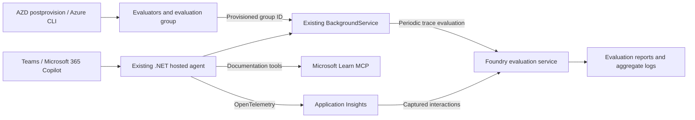

# Microsoft Foundry Agents Auto-Evaluations

This demo evaluates real interactions with a .NET hosted agent reached through the existing Teams and Microsoft 365 Copilot integration. Microsoft Foundry reads the conversations already captured in Application Insights and runs built-in and custom evaluators without replaying user requests.

For a beginner walkthrough in Spanish, including PowerShell and WSL/Bash scripts to generate multi-turn test conversations against the deployed agent, see [the guided demo](demo.es.md).

The generators use `azd ai agent invoke --output raw`, read the Responses stream through `response.completed`, and require nonempty assistant text before counting a successful turn. During live verification, the default CLI presentation returned success without text for some turns; consuming the complete stream avoided those empty interactions. A successful CLI exit alone is not evidence of a usable response or an evaluated trace.

## Architecture and workflow



The existing `AgentHost`, Responses endpoint, dependency injection, options, models, and background service remain in place. This implementation does not change channel publication, add another service, or introduce a trace-export database or dataset-upload pipeline. Foundry selects the evaluation data from the connected Application Insights resource.

For Microsoft technology questions, the agent is instructed to consult the public [Microsoft Learn MCP server](https://learn.microsoft.com/en-us/training/support/mcp) at `https://learn.microsoft.com/api/mcp` and cite source URLs returned by its tools. The existing Foundry SDK declares only `microsoft_docs_search`, `microsoft_docs_fetch`, and `microsoft_code_sample_search`; the backing Responses service invokes them remotely. These read-only tools need no authentication and are configured without interactive approval. No Toolbox, AI Search index, PDF ingestion, or additional packages are required. Queries reach a public documentation service: use nonsensitive search terms, not secrets or private conversation details.

1. The existing hosting integration emits OpenTelemetry spans for user interactions.
2. During `azd provision`, the `postprovision` hook registers missing custom evaluator definitions and creates or reuses a matching evaluation group. Deployment passes its ID to `FoundryContinuousEvaluationService`; the agent never publishes evaluator definitions or creates groups.
3. The first evaluation starts after the configured polling interval, currently five minutes. Subsequent evaluations use the same interval and select up to 50 traces from the preceding hour.
4. Foundry evaluates the captured query/response data with four built-in and two custom evaluators.
5. The background service polls for completion and logs the report URL and per-evaluator passed/failed counts. Inspect individual scores and judge explanations in Foundry's evaluation report.

This is application-managed periodic evaluation, not a native Foundry `responseCompleted` continuous-evaluation rule. The timer runs only while the hosted agent process runs. Trace evaluation and the evaluator catalog use preview APIs already available in the project's pinned SDK dependencies.

## Evaluation criteria

| Evaluator | Measures | Score and passing rule |
| :--- | :--- | :--- |
| `builtin.relevance` | Whether the answer addresses the question | 1-5, at least 3 |
| `builtin.coherence` | Logical organization and consistency | 1-5, at least 3 |
| `builtin.fluency` | Linguistic fluency | 1-5, at least 3 |
| `builtin.violence` | Violence-related content severity | 0-7, at most 3 |
| `official_microsoft_links` | Compliance of explicit response URLs with the demo's link policy | 0 or 1, must be 1 |
| `corporate_communication` | Language choice, professional tone, and practical guidance | 1-5, at least 4 |

Relevance, coherence, fluency, and corporate communication use the configured judge deployment. Violence uses the hosted safety evaluator instead. These scores do not establish factual accuracy, customer satisfaction, or regulatory compliance. Groundedness is deliberately omitted: the evaluation maps query/response data, not retrieved documentation as a dedicated grounding context. An allowed-domain link alone does not prove that the answer is supported by its source.

The published support for coherence and fluency is currently English. Use English conversations to demonstrate those metrics; Spanish results are not validated by this demo. The custom communication rubric can assess the requested language, but its scores still require calibration and human review. See the [general-purpose evaluator reference](https://learn.microsoft.com/en-us/azure/foundry/concepts/evaluation-evaluators/general-purpose-evaluators).

### Deterministic Microsoft link policy

The [Python evaluator](infra/foundry/official_microsoft_links.py) checks explicit web URLs in the response. Every inspected URL must use HTTPS, have no user information or nonstandard port, and match one of these exact hosts:

- `learn.microsoft.com`
- `azure.microsoft.com`
- `techcommunity.microsoft.com`
- `devblogs.microsoft.com`
- `support.microsoft.com`

Missing or empty responses fail. A nonempty response with no links passes because it contains no link-policy violation. Subdomains outside the exact list, HTTP, external domains, and shorteners such as `aka.ms` fail. The evaluator does not open URLs, follow redirects, verify availability or factual support, require citations, or provide a security boundary. It is a deterministic demonstration policy, not a complete URL or Markdown security parser.

The Python source belongs to infrastructure and is published to Foundry's evaluator catalog by Azure CLI during provisioning, not embedded in the .NET assembly. Foundry executes it in its sandbox with no network access. The evaluator imports only `re`: the live grader rejects `urllib.parse`, even though it is part of Python's standard library. Its input schema declares `response` directly, matching the evaluation's `data_mapping`; adding a required `item` wrapper causes evaluation validation to fail. The agent container does not need Python, a Python SDK, or an additional endpoint. The code evaluator still receives `deployment_name` because the service's initialization contract requires it, not because its grading function invokes a model.

### Corporate communication judge

The [judge prompt](infra/foundry/corporate_communication.txt) assigns an ordinal score from 1 to 5 using three criteria: respond in the appropriate language, maintain a professional and direct tone, and provide practical guidance appropriate to the request. It returns Foundry's `result` and `reason` JSON contract and instructs the judge to treat conversation content as untrusted data rather than grading instructions.

These evaluators measure the existing agent; they do not rewrite its instructions or block its answers. A failed policy score is an observation to review, not a fabricated demonstration result or a claim that the agent enforced the policy.

## Configuration and runtime behavior

Configure Foundry resources in [infra/foundry/evaluation.json](infra/foundry/evaluation.json) and [infra/foundry/evaluators.json](infra/foundry/evaluators.json). The first file selects evaluators, thresholds and the judge deployment; the second declares custom definitions and their Python or prompt source files. Changes take effect on the next `azd provision`, followed by deployment.

The root `postprovision` hook selects [PowerShell](scripts/Initialize-FoundryEvaluation.ps1) on Windows and [Bash](scripts/initialize-foundry-evaluation.sh) on Linux/macOS/WSL. Windows requires PowerShell 7.4 or later; POSIX systems require Bash, `jq`, and `sha256sum` or `shasum`, without PowerShell. Both implementations use the same configuration and generate identical payloads, catalog names and group fingerprints. Azure CLI must be authenticated separately from `azd`. The hook calls Foundry's data-plane API through `az rest` with the `https://ai.azure.com` token audience and saves `FOUNDRY_EVALUATION_ID` to the selected azd environment. The deployment identity needs evaluator and evaluation-group write permissions on the project. A failed publication stops provisioning; it never silently falls back to runtime registration.

Validate payloads without accessing Azure:

```powershell
./scripts/Initialize-FoundryEvaluation.ps1 -ValidateOnly
```

On Linux/macOS/WSL, validate the same payloads without PowerShell:

```bash
bash scripts/initialize-foundry-evaluation.sh --validate-only
```

Both validation commands read configuration without authenticating or accessing Azure.

After changing Foundry configuration, run `azd provision -e relv` and `azd deploy agent-autoevaluations -e relv`, or use `azd up -e relv`. These commands modify Azure and can incur charges. `azd deploy` alone does not publish changed evaluator definitions. The hook can also be rerun with `azd hooks run postprovision -e relv`; it creates missing configuration but never submits conversations or evaluation runs.

Provisioning settings:

| Setting | Current value | Meaning |
| :--- | :--- | :--- |
| `EvaluationName` | `evaluation-demo-insights` | Evaluation group display name |
| `ModelDeploymentName` | `gpt-6.1-sol` | Judge deployment in the target Foundry account |
| `Evaluators` | Six criteria | Built-in and custom evaluator selection |
| `QualityPassThreshold` | `3` | Minimum built-in quality score |
| `CommunicationPassThreshold` | `4` | Minimum communication score |
| `SafetySeverityThreshold` | `3` | Maximum acceptable violence severity |

Configure runtime scheduling in [appsettings.json](src/Foundry.Agents.Autoevaluation.Demo/appsettings.json) or with corresponding .NET environment variables. [azure.yaml](azure.yaml) passes `FOUNDRY_EVALUATION_ID` as `FoundryContinuousEvaluationOptions__EvaluationId`. Local runs with evaluations enabled must supply that ID too; missing configuration fails startup rather than creating resources.

The following table reflects the checked-in demo configuration, with code defaults for omitted settings. Keep the judge deployment available in the target Foundry account.

| Setting | Current value | Meaning |
| :--- | :--- | :--- |
| `IsEnabled` | `true` | Run evaluations using the provisioned group |
| `EvaluationId` | From `FOUNDRY_EVALUATION_ID` | Provisioned group ID; required when evaluation and sampling are enabled |
| `PollingIntervalMinutes` | `5` | Interval between evaluation attempts; omit it to use the lookback window |
| `LookbackHours` | `1` | UTC trace-selection window |
| `MaxTracesPerRun` | `50` | Maximum requested trace count before cap scaling |
| `TraceSamplingPercentage` | `100` | Scale the trace cap; `0` skips runs |
| `ResultPollingIntervalSeconds` | `10` | Interval between run-status checks |
| `ResultTimeoutMinutes` | `10` | Local result-wait limit, not remote cancellation |

`TraceSamplingPercentage` is not a random probability applied to each conversation. It scales the maximum requested count, rounded with a minimum of one when positive. For example, 50 percent of the default cap requests at most 25 traces. Foundry performs trace selection; do not interpret this as a statistically representative sample or complete traffic coverage.

Trace selection uses the deployed agent name and explicit UTC start/end timestamps through `azure_ai_trace_data_source_preview` with an `agent_filter`. Confirm that the emitted `gen_ai.agent.name` matches `agent-autoevaluations`. It does not use the in-memory framework agent ID as a published Foundry ID.

The demo intentionally keeps the `agent_name` filter: evaluating real conversations is the goal, and pinning a specific agent version is not currently a requirement. Using `agent_id` is also valid, but changing the filter would add identity-resolution work without a demonstrated need. Name-only version-selection behavior has not been validated in this demo; do not assume that this filter includes every version or automatically covers the full conversation history.

For an ID-based filter, `agent_id` must match the emitted `gen_ai.agent.id`. The [trace evaluation requirements](https://learn.microsoft.com/en-us/azure/foundry/observability/how-to/cloud-evaluation-deployed-interactions#trace-data-requirements) describe that value as `agent-name:version`. Separately, the [hosted agent runtime contract](https://learn.microsoft.com/en-us/azure/foundry/agents/concepts/hosted-agent-contract#platform-environment-variables) describes `FOUNDRY_AGENT_ID` as a stable GUID. Neither that GUID nor the local framework's `agent.Id` should be assumed to match the trace identifier.

An ID-based filter could follow future deployed versions without manual updates by reading the platform-injected `FOUNDRY_AGENT_NAME` and `FOUNDRY_AGENT_VERSION` at startup and passing the corresponding `name:version` identifier to the evaluation service. First verify that the .NET hosting integration emits that exact value in `gen_ai.agent.id`. Each new version's container would then evaluate its own version, not all historical versions. This alternative is not implemented; the demo retains the simpler name-based filter.

Starting the agent with evaluation enabled creates only paid evaluation runs, never evaluator versions or groups. Provisioning uses canonical JSON and normalized source line endings for content-hashed catalog names. Existing definitions are verified before reuse; a conflicting definition fails provisioning. Evaluation groups are reused only when their name and configuration fingerprint match; changing criteria, thresholds, or judge deployment creates another group and preserves historical results. No historical resources are deleted automatically. This is scripted provisioning through AZD, not native Terraform lifecycle management of evaluator assets.

Use one running replica for this demonstration. Each replica has its own timer; multiple replicas, restarts, overlapping windows, or telemetry ingestion delays can cause duplicate or missed evaluations. There is no distributed scheduler, durable watermark, or exactly-once guarantee. If result polling times out, the remote evaluation continues; review it in Foundry. Results from these periodic runs are not guaranteed to appear in the native agent continuous-monitoring dashboard.

## Trace and permission prerequisites

The Teams/Copilot integration must already reach the deployed agent. Before demonstrating evaluations, verify the following without adding duplicate telemetry exporters:

- The Foundry project has a working Application Insights connection and network access for telemetry ingestion and evaluation queries.
- Captured spans include `gen_ai.operation.name=invoke_agent`, agent identity attributes, and populated `gen_ai.input.messages` / `gen_ai.output.messages`. Missing conversation content can produce null quality scores. Recording content requires appropriate consent, redaction, retention, and access controls.
- The application identity submitting evaluations has **Foundry User** or equivalent permissions. Model inference requires the appropriate Foundry account scope, not only project access.
- The deployment identity publishing Foundry configuration has project permissions to create evaluators and evaluation groups. This is separate from the agent's runtime permissions.
- The project managed identity has **Reader** on the connected Application Insights resource. Workspace-only permission mode additionally requires **Log Analytics Reader** on the linked workspace. Protected tables and DataActionsOnly mode require the additional roles described in the permissions reference.
- Your portal identity has access to the evaluation results and the relevant logs. Do not print or commit connection strings, tokens, or raw private conversations when troubleshooting.

See [trace data requirements](https://learn.microsoft.com/en-us/azure/foundry/observability/how-to/cloud-evaluation-deployed-interactions#trace-data-requirements) and [evaluation permissions](https://learn.microsoft.com/en-us/azure/foundry/observability/how-to/evaluation-permissions). Verify these prerequisites in your Azure environment before the demonstration.

## Demonstration walkthrough

1. Verify the trace and permission prerequisites, judge deployment, and single-replica setup. Use consented, nonsensitive interactions.
2. Through the existing Teams or Copilot channel, ask questions such as "Explain what Microsoft Foundry is in two sentences", "Give me three steps to review a Foundry agent's traces", and "Link to official Microsoft Learn documentation about evaluating agents". These exercise factual-answer, procedural, and link-policy criteria without promising particular scores.
3. Confirm that actual interaction spans and message content arrive in Application Insights. Allow for ingestion delay; the first scheduled run can be empty before users interact.
4. Wait for the next configured run. The checked-in demo uses `PollingIntervalMinutes=5`; set it to `60` and redeploy when hourly evaluations are preferable. The one-hour lookback overlaps with five-minute runs, so traces can be evaluated again.
5. In the Foundry project, open **Evaluations**, find `evaluation-demo-insights`, and inspect the run. Use the logged evaluation/run IDs and report URL to identify the matching group when historical configurations share the same display name.
6. Compare built-in scores with the link-policy result and communication judge's explanation. Inspect failures and null/error results before interpreting aggregates. Correlate examples with their source traces; a run with no usable interactions is not evidence of passing quality.
7. Improve the agent only after reviewing actual failures. Keep human review in the loop and compare similar traffic windows and evaluator configurations.

### Verified evaluation in relv

The following results belong to the earlier `nfjp5` deployment, before moving publication into provisioning. That deployment has been deleted, so its report links may no longer resolve. They are historical observations, not verification of the new provisioning workflow or a reconstructed environment.

On October 25, 2026, hosted-agent version `19` created run `evalrun_84f60804ce2c4b0597877b34bcc85a38` in group `eval_619d7f17330a459aa6de5ee68dd44b75` (`evaluation-demo-insights`). The run completed with seven evaluated items, all six criteria populated, and zero errored or skipped results. Both `official_microsoft_links` and `corporate_communication` returned passing scores for all seven items. These are real evaluation results from demo traffic, not a guarantee of future scores or production quality.

A later periodic run, `evalrun_6a88e1151b1048f599e94bd895f2e70b`, processed 28 items and exposed 13 empty responses from the earlier CLI traffic. Both custom evaluators failed those items, while relevance, coherence, and fluency reported `Response string cannot be empty`. Historical failures remain visible. After switching the generators to the complete raw stream, a live three-turn conversation returned nonempty text in every turn; trace ingestion and later evaluation still require separate verification.

The [historical Foundry evaluation report](https://ai.azure.com/nextgen/r/UIm8hLgORwWauJsYGYu3uQ,rg-demo-foundry-agents-autoevaluation-nfjp5,,aif-demo-foundry-agents-autoevaluation-nfjp5,proj-demo-foundry-agents-autoevaluation-nfjp5/build/evaluations/eval_619d7f17330a459aa6de5ee68dd44b75/run/evalrun_84f60804ce2c4b0597877b34bcc85a38) identifies that earlier result. In an active deployment, find custom definitions under **Evaluations > Evaluator catalog** and scored runs under **Evaluations**. Their catalog names have a content-hash suffix. Use the run ID or report URL instead of selecting only by display name.

If setup fails, distinguish `PermissionDenied` from a schema error such as `MissingRequiredDataMapping`. If a created run reaches `failed`, inspect its `error` object: a forbidden Python import is a grader-runtime failure, not an RBAC failure. The background service logs that remote error and retries on the next interval; successful aggregate results use the API's `testing_criteria` field.

## Deploy the hosted agent

Run commands from the repository root. Install Azure Developer CLI with the `azure.ai.agents` extension (at least `1.0.0-beta.12`), Azure CLI, and Terraform matching the pinned provider requirements. Authenticate both CLIs against the deployment tenant and subscription. The postprovision hook uses PowerShell 7.4 or later on Windows, or Bash, `jq`, and `sha256sum` or `shasum` on Linux/macOS/WSL. The separate postdeploy identity hook uses PowerShell on Windows, or Bash and `jq` on POSIX systems. PowerShell is not required for either hook on Linux/macOS/WSL; use native Linux installations of Azure CLI and `azd` inside WSL. Local Docker is not required: Azure Container Registry Tasks builds the image remotely.

Select an azd environment with `AZURE_SUBSCRIPTION_ID`, `AZURE_LOCATION`, and `TF_VAR_suffix` configured. The suffix must contain exactly five lowercase letters or digits. Choose a region that supports both hosted agents and the model configured in Terraform, with sufficient quota.

Provision the infrastructure, build and publish the image, and deploy the agent:

```powershell
azd up
```

The native azd workflow provisions Terraform's `backend` and `resources` layers before publishing and deploying `agent-autoevaluations` to the Foundry project. Package preparation can overlap with provisioning; the remote image build and publication run once the infrastructure is available. Keep the native workflow instead of overriding `workflows.up`, so service-target extensions remain available throughout execution. The Docker build uses the repository root as its context so the shared .NET build and package configuration is available. Images use azd-generated version tags.

After a complete `azd down`, the `postdown` hook in [azure.yaml](azure.yaml) checks the local `backend` layer's state. Only when it contains no managed resources or outputs does the hook remove `.azure/<environment>/infra/resources/.terraform`, the resources layer's local initialization cache. The next `azd up` initializes against the newly provisioned backend instead of retaining a deleted state account. The [PowerShell](scripts/Reset-TerraformBackendCache.ps1) and [Bash](scripts/reset-terraform-backend-cache.sh) implementations preserve actual state files outside that cache, environment settings, and other environments. Repeating the cleanup is a no-op; missing backend state or remaining resources/outputs keep the cache, while malformed state and linked paths fail without deleting it. The POSIX cleanup requires Bash and `jq`.

This hook prevents stale initialization after future complete teardowns; it does not repair a cache already pointing at a previous backend. For that recovery, first confirm that the previous deployment was fully destroyed and that no state migration is needed, then use [`terraform init -reconfigure`](https://developer.hashicorp.com/terraform/cli/commands/init#backend-initialization) with the current generated backend configuration and azd's environment-specific `TF_DATA_DIR`. Do not enable unconditional reconfiguration for every `up`: an unintended backend change could otherwise disconnect Terraform from resources it still manages. Model-quota failures stop Terraform before `postprovision`: neither Foundry publication nor agent deployment has succeeded in that case.

Terraform exports the ACR and Foundry settings into the azd environment, connects the project to ACR and Application Insights, and grants the provisioning identity Foundry User access on the project. The project managed identity already receives `AcrPull` through the ACR module. The provisioning identity also needs resource creation and role-assignment permissions; the deployment identity needs permission to run ACR Tasks and publish images. If provisioning and deployment use different identities, grant the deployment identity Foundry project access separately. See the [hosted agent permissions reference](https://learn.microsoft.com/azure/foundry/agents/concepts/hosted-agent-permissions).

The demo uses the first deployment in Terraform's `foundry_models` list. Foundry injects `FOUNDRY_PROJECT_ENDPOINT` and `APPLICATIONINSIGHTS_CONNECTION_STRING` into the hosted container; do not set them in the agent service definition. The server listens on port `8088`.

### Authorize the hosted agent's evaluation service

Hosted code uses the agent's own instance identity, not the project managed identity. Its default access does not authorize the evaluator catalog or evaluation management APIs. The service-level `postdeploy` hook in [azure.yaml](azure.yaml) reads the deployed agent's `instance_identity.principal_id` and grants **Foundry User** on this demo's Foundry account, covering the evaluation APIs and judge-model inference without subscription-wide access. See [agent identity](https://learn.microsoft.com/azure/foundry/agents/concepts/agent-identity) and [evaluation permissions](https://learn.microsoft.com/azure/foundry/observability/how-to/evaluation-permissions).

Run `azd up` only once: it provisions the infrastructure, deploys the agent, and then runs this hook automatically. The same hook runs after `azd deploy agent-autoevaluations`. It uses [PowerShell](scripts/Grant-HostedAgentEvaluationRole.ps1) on Windows and [Bash](scripts/grant-hosted-agent-evaluation-role.sh) on POSIX systems, checks for an existing unconditional assignment before creating one, and fails the deployment command if checking or granting access fails. The Azure CLI identity needs `Microsoft.Authorization/roleAssignments/read` and `Microsoft.Authorization/roleAssignments/write` on the account, such as through Role Based Access Control Administrator at that scope. No principal ID needs to be saved manually in the azd environment. See [azd lifecycle hooks](https://learn.microsoft.com/azure/developer/azure-developer-cli/azd-extensibility).

The agent can start before `postdeploy` grants the role, and RBAC propagation is not immediate. Its initial evaluation can therefore log `PermissionDenied`; the existing background service retries setup at the next configured interval while the process remains running. The checked-in interval is five minutes. Without a polling override, the interval matches the one-hour lookback. The hook does not restart the agent, wait for propagation, or trigger an evaluation.

If the hook fails, correct its CLI authentication or RBAC permissions and rerun only the service hook, with deployment authorization:

```powershell
azd hooks run postdeploy --service agent-autoevaluations -e <name_of_your_environment>
```

Use your environment name. The hook discovers the current identity on each deployment, including when an agent has been recreated. It does not revoke roles from previous identities. For environments that used the earlier Terraform-managed assignment, a `removed` block with `destroy = false` relinquishes Terraform ownership during the next authorized provisioning without revoking the existing Azure role. The old `TF_VAR_hosted_agent_principal_id` value is no longer used. Review the provisioning preview before applying, including any unrelated changes; no second `azd up` is required for this transition.

After provisioning, publish code changes without rerunning Terraform:

```powershell
azd deploy agent-autoevaluations
```

Each deployment creates a new agent version. To check the deployed agent and send a smoke-test request, which incurs model usage charges:

```powershell
azd ai agent show
azd ai agent invoke "Introduce yourself in one sentence."
```

## Build locally

Build from the repository root with the .NET SDK selected by the repository:

```powershell
dotnet build src/Foundry.Agents.Autoevaluation.Demo/Foundry.Agents.Autoevaluation.Demo.csproj --verbosity minimal
```

The build does not start the agent or run evaluations. Verify trace ingestion, permissions, and evaluation results against your configured Foundry project before the demonstration.

## References

- [Evaluate deployed interactions without replaying requests](https://learn.microsoft.com/en-us/azure/foundry/observability/how-to/cloud-evaluation-deployed-interactions)
- [Create code-based and prompt-based custom evaluators](https://learn.microsoft.com/en-us/azure/foundry/concepts/evaluation-evaluators/custom-evaluators)
- [Retrieve evaluation results and reports](https://learn.microsoft.com/en-us/azure/foundry/observability/how-to/cloud-evaluation-results)
- [General-purpose evaluator support and interpretation](https://learn.microsoft.com/en-us/azure/foundry/concepts/evaluation-evaluators/general-purpose-evaluators)
- [Evaluation identity and permission requirements](https://learn.microsoft.com/en-us/azure/foundry/observability/how-to/evaluation-permissions)
