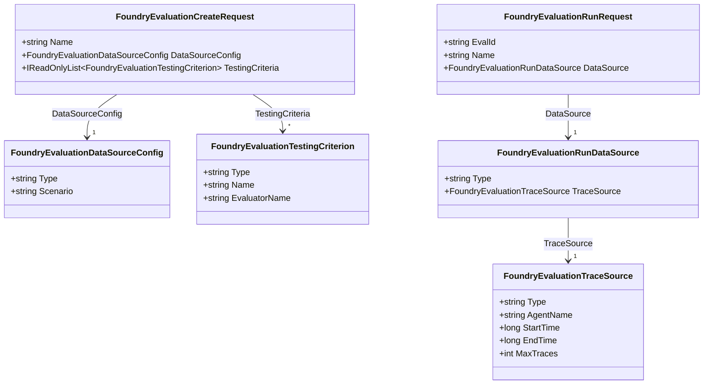

# Evaluation request models

The six classes in the `Models` folder describe the JSON requests used to define an evaluation group and start evaluation runs against agent traces captured in Application Insights. They belong to the `Foundry.Agents.Autoevaluation.Demo.Models` namespace.

An **evaluation group** defines what to measure: the trace scenario and its evaluators. An **evaluation run** selects which traces to evaluate: the deployed agent, time window, and trace limit. These models carry request data; they do not collect telemetry, execute evaluators, or store evaluation results.

## Class relationships

The diagram highlights nested objects and identifying properties. The property tables below describe the complete models.

The arrows represent object references, not inheritance. `TestingCriteria` is a collection; the other nested properties each hold one object in the requests built by the application.

The two request trees are connected through a **remote evaluation group ID**, not a C# object reference. `FoundryEvaluationRunRequest.EvalId` identifies the group created with `FoundryEvaluationCreateRequest`, or an existing compatible group reused by the service. A run does not embed the group definition or repeat its evaluators.

## Evaluation group definition

### FoundryEvaluationCreateRequest

[Models/FoundryEvaluationCreateRequest.cs](Models/FoundryEvaluationCreateRequest.cs) is the root request for creating an evaluation group.

| C# property | JSON field | C# type | Purpose |
| :--- | :--- | :--- | :--- |
| `Name` | `name` | `string` | Group name, taken from `EvaluationName` in the options |
| `DataSourceConfig` | `data_source_config` | `FoundryEvaluationDataSourceConfig` | Declares that the group evaluates traces |
| `TestingCriteria` | `testing_criteria` | `IReadOnlyList<FoundryEvaluationTestingCriterion>` | Evaluators and their input mappings and parameters |
| `Metadata` | `metadata` | `IReadOnlyDictionary<string, string>` | Stores `configuration_hash` for compatible group reuse |

All four properties are `required`. The configuration builder computes `configuration_hash` as a SHA-256 hash of the serialized trace scenario and testing criteria. The service checks both the group name and this hash before reusing a remote group.

### FoundryEvaluationDataSourceConfig

[Models/FoundryEvaluationDataSourceConfig.cs](Models/FoundryEvaluationDataSourceConfig.cs) declares the kind of data the evaluation group accepts. It does not select an agent or a time window.

| C# property | JSON field | C# type | Default value |
| :--- | :--- | :--- | :--- |
| `Type` | `type` | `string` | `azure_ai_source` |
| `Scenario` | `scenario` | `string` | `traces` |

Neither property is `required`; both receive their defaults when the configuration builder creates the object.

### FoundryEvaluationTestingCriterion

[Models/FoundryEvaluationTestingCriterion.cs](Models/FoundryEvaluationTestingCriterion.cs) describes one evaluator within the group. The builder creates one instance for each configured evaluator.

| C# property | JSON field | C# type | Purpose or default |
| :--- | :--- | :--- | :--- |
| `Type` | `type` | `string` | Defaults to `azure_ai_evaluator` |
| `Name` | `name` | `string` | Short criterion name, such as `fluency` |
| `EvaluatorName` | `evaluator_name` | `string` | Catalog name, such as `builtin.fluency`, or a custom evaluator's content-hashed name |
| `DataMapping` | `data_mapping` | `IReadOnlyDictionary<string, string>` | Maps evaluator inputs to trace fields |
| `InitializationParameters` | `initialization_parameters` | `IReadOnlyDictionary<string, object>` | Supplies evaluator-specific settings |

Every property except `Type` is `required`.

The current builder maps `response` to `{{item.response}}`. It also maps `query` to `{{item.query}}`, except for `builtin.fluency` and `official_microsoft_links`. These strings are evaluator field expressions, not values resolved by the model classes.

Initialization parameters depend on the evaluator. The current configuration uses `threshold` for violence, `deployment_name` and `pass_threshold` for official Microsoft links, and `deployment_name` and `threshold` for the other evaluators.

## Evaluation run selection

### FoundryEvaluationRunRequest

[Models/FoundryEvaluationRunRequest.cs](Models/FoundryEvaluationRunRequest.cs) is the root request for starting a run under an existing evaluation group.

| C# property | JSON field | C# type | Purpose |
| :--- | :--- | :--- | :--- |
| `EvalId` | `eval_id` | `string` | Remote evaluation group ID |
| `Name` | `name` | `string` | Run name formed from the group ID and the current UTC timestamp |
| `DataSource` | `data_source` | `FoundryEvaluationRunDataSource` | Describes the traces to select for this run |

All three properties are `required`. The service also passes `EvalId` to the client's `CreateEvaluationRunAsync` call.

### FoundryEvaluationRunDataSource

[Models/FoundryEvaluationRunDataSource.cs](Models/FoundryEvaluationRunDataSource.cs) wraps the concrete trace selector for one run. Unlike `FoundryEvaluationDataSourceConfig`, it describes the data to evaluate now rather than the group's general scenario.

| C# property | JSON field | C# type | Purpose or default |
| :--- | :--- | :--- | :--- |
| `Type` | `type` | `string` | Defaults to `azure_ai_trace_data_source_preview` |
| `TraceSource` | `trace_source` | `FoundryEvaluationTraceSource` | Required deployed-agent filter and time window |

### FoundryEvaluationTraceSource

[Models/FoundryEvaluationTraceSource.cs](Models/FoundryEvaluationTraceSource.cs) selects captured traces using the deployed agent name recorded in telemetry, not an in-memory framework agent ID.

| C# property | JSON field | C# type | Purpose or default |
| :--- | :--- | :--- | :--- |
| `Type` | `type` | `string` | Defaults to `agent_filter` |
| `AgentName` | `agent_name` | `string` | Deployed agent name supplied to the service |
| `StartTime` | `start_time` | `long` | Window start as Unix seconds |
| `EndTime` | `end_time` | `long` | Window end as Unix seconds |
| `MaxTraces` | `max_traces` | `int` | Maximum number of traces requested |

Every property except `Type` is `required`. The builder captures the current UTC time once, uses it as `EndTime`, and subtracts `LookbackMinutes` in minutes to obtain `StartTime`.

For positive sampling percentages, `MaxTraces` is `MaxTracesPerRun * TraceSamplingPercentage / 100`, rounded with `Math.Round` and constrained to at least one. This changes the requested trace limit; the models do not implement random sampling. The service skips runs when sampling is zero, and the builder rejects nonpositive percentages.

## Construction and submission

The models are used by [Services/FoundryEvaluationConfiguration.cs](Services/FoundryEvaluationConfiguration.cs) and [Services/FoundryContinuousEvaluationService.cs](Services/FoundryContinuousEvaluationService.cs):

1. `CreateRequest` builds the group definition, evaluator criteria, and configuration hash.
2. The service reuses a matching group or submits the definition through `CreateEvaluationAsync` and reads the returned ID.
3. `CreateRunRequest` builds a run using that ID and a fresh trace-selection window.
4. The service submits the run through `CreateEvaluationRunAsync`, then polls its results. Response data is read separately with `JsonDocument`; these six classes only model requests.

Before submission, the service serializes each root request with `BinaryData.FromObjectAsJson` and wraps it in `BinaryContent`. The `[JsonPropertyName]` attributes define the JSON field names shown in the tables.

## Shared design considerations

- All six classes are `internal sealed`: they are implementation details of the demo and do not participate in an inheritance hierarchy.
- Properties use `init` accessors. `required` properties must be supplied during normal C# object initialization, but this does not validate their values at runtime.
- Default discriminator strings such as `Type` and `Scenario` are initialization defaults, not constants; callers can override them during initialization.
- `IReadOnlyList` and `IReadOnlyDictionary` expose read-only interfaces, but do not guarantee that their underlying collections are immutable.
- Configuration construction, validation, network calls, and scheduling belong outside these data-only classes.
